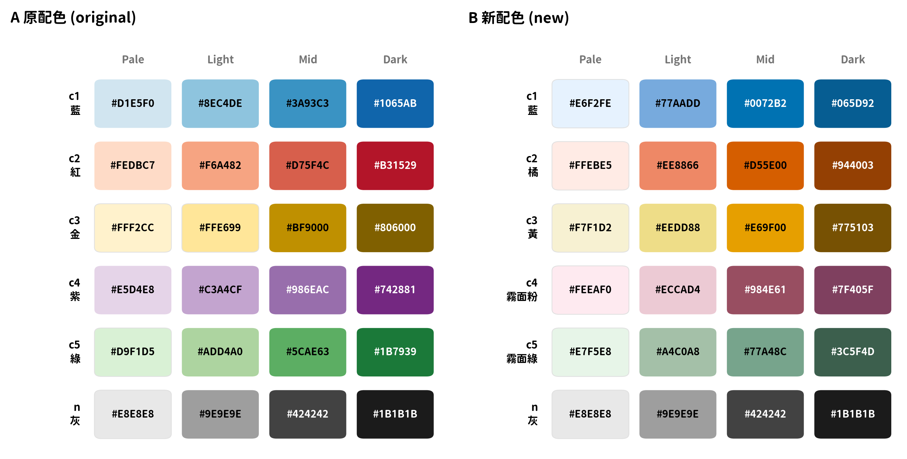

# figkit

A personal figure style kit for TikZ and matplotlib: two academic color palettes, the GenSenRounded B font, 1.5 pt strokes and rounded arrows, plus the Claude Code skill `figure-style`.


## Palettes
Every slot and shade, with hex codes (regenerate with `palette_swatches demo/palette_swatches.png`):



The colors are defined in `tex/palette_original.tex`, `tex/palette_new.tex` and `python/figkit/__init__.py`; change both places together.

## Install
```bash
git clone https://github.com/fanchiayu/figkit.git ~/figkit
cd ~/figkit && ./install.sh
```
Requirements:
- TeX Live with LuaLaTeX
- poppler-utils
- Python 3 with matplotlib, pillow and numpy

`install.sh` links everything into place, reports anything missing, and compiles a demo figure as a self-test. To update, run `git pull`.

## Usage
TikZ (compiled with LuaLaTeX):
```latex
\documentclass[border=8pt]{standalone}
\providecommand{\figpalette}{new}   % or: original
\input{figstyle}
```
Draw only with the slot colors `c1`–`c5` and `n` (neutral gray). Each comes in four shades: `pale`, `light`, `mid`, `dark`. Use the `slotbox=c2` style for boxes and `arr` for arrows. For a full example, see `demo/demo_figure.tex`.

```bash
compile_tikz fig.tex [dpi]  # -> fig.pdf + fig.png (default 600 dpi)
compare_palettes fig.tex    # both palettes side by side + colorblind simulation
palette_swatches [out.png]  # plain swatch chart of both palettes, with hex codes
```

matplotlib:
```python
from figkit import PALETTES, use_style
use_style()
color = PALETTES["new"]["c2"]["mid"]
```

Data plots (bars, lines, scatter) follow their own rules (1.0 pt axes, a y axis on every panel, a light grid, Light-fill bars with Mid edges, Mid markers without outlines); see section 5 of `skill/figure-style/SKILL.md`:
```python
from figkit import PALETTES, BASELINE_GRAY, MARKER_AREA, use_style, style_axes
use_style(data=True)                     # 1.0 pt axes, 8/9 pt text, embeddable PDF fonts
fig, ax = plt.subplots()
ax.scatter(x, y, s=22 * MARKER_AREA["^"], marker="^", color=PALETTES["original"]["c1"]["mid"], edgecolor="none")
style_axes(ax, box=True, xgrid=True, grid_width=0.5)   # bars/lines: style_axes(ax)
```

## Font
`fonts/GenSenRounded2TW-B.otf` is GenSenRounded2 TW B by [ButTaiwan](https://github.com/ButTaiwan/gensen-font), licensed under the SIL Open Font License 1.1 (see `fonts/SIL_Open_Font_License_1.1.txt`).
