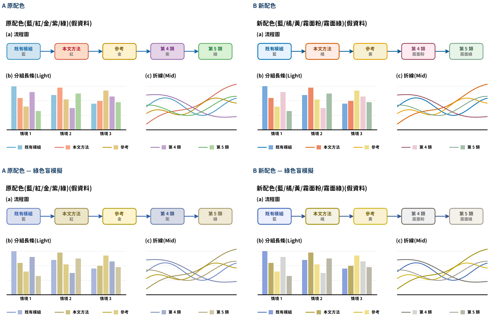

# figkit

A personal figure style kit for TikZ and matplotlib: two academic color palettes, the GenSenRounded B font, 1.5 pt strokes and rounded arrows, plus the Claude Code skill `figure-style`.



## Install
```bash
git clone https://github.com/fanchiayu/figkit.git ~/figkit
cd ~/figkit && ./install.sh
```
Requirements:
- TeX Live with LuaLaTeX
- poppler-utils
- Python 3 with matplotlib, pillow and numpy

`install.sh` links everything into place, reports anything missing, and compiles a demo figure as a self-test. To update, run `git pull`.

## Usage
TikZ (compiled with LuaLaTeX):
```latex
\documentclass[border=8pt]{standalone}
\providecommand{\figpalette}{new}   % or: original
\input{figstyle}
```
Draw only with the slot colors `c1`–`c5` and `n` (neutral gray). Each comes in four shades: `pale`, `light`, `mid`, `dark`. Use the `slotbox=c2` style for boxes and `arr` for arrows. For a full example, see `demo/demo_figure.tex`.

```bash
compile_tikz fig.tex        # -> fig.pdf + fig.png
compare_palettes fig.tex    # both palettes side by side + colorblind simulation
```

matplotlib:
```python
from figkit import PALETTES, use_style
use_style()
color = PALETTES["new"]["c2"]["mid"]
```

## Font
`fonts/GenSenRounded2TW-B.otf` is GenSenRounded2 TW B by [ButTaiwan](https://github.com/ButTaiwan/gensen-font), licensed under the SIL Open Font License 1.1 (see `fonts/SIL_Open_Font_License_1.1.txt`).
